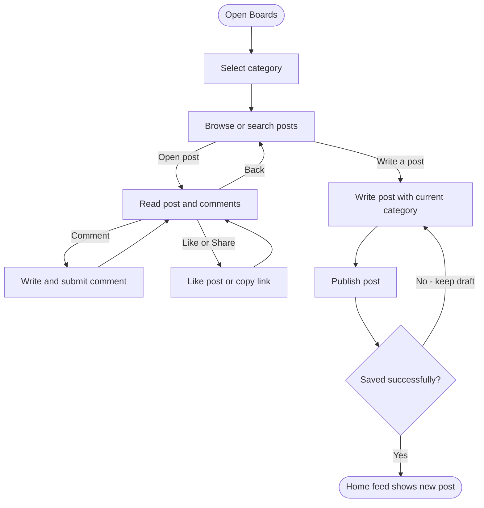

# Campusly Board Flowchart

Signed-in user flow for web and mobile.

- **Categories:** Q&A, Campus info, Events, Study resources, Marketplace, Jobs.
- **New post:** Current category are preselected. Body required; title optional. Choose name.
- **Shared content:** The new post also appears in the home feed.
