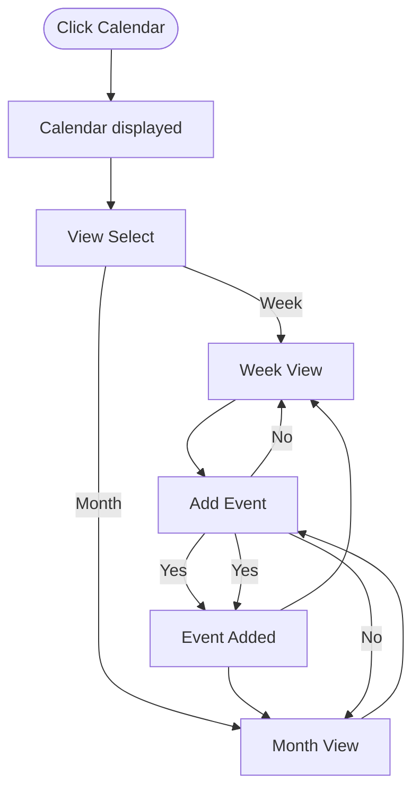

# Campusly Calendar Flowchart

Calendar flow for choosing a view and adding an event.

- **View selection:** Open Calendar and choose the Week or Month view.
- **Add event:** Start adding an event from either view.
- **Return to calendar:** After the event is added, or if the user does not add it, return to the selected view.
