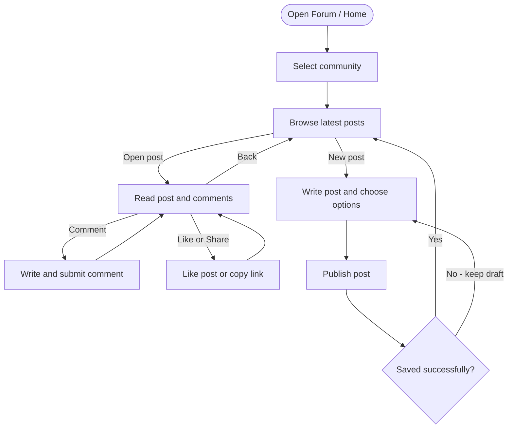

# Campusly Forum Flowchart

Signed-in user flow for web and mobile.

- **Community:** Campus, Program, or Class. Like and Share also work directly on feed cards.
- **New post:** Body required; title optional. Choose community, category, and name or Anonymous.